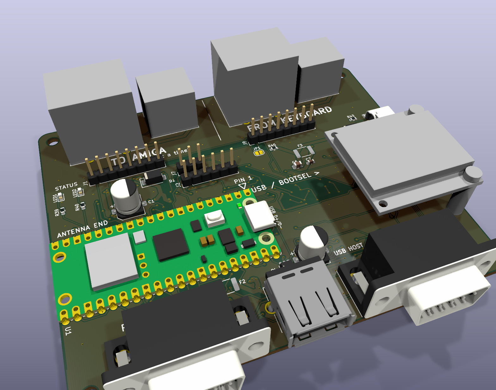

# hid-pico Amiga UX

USB and Bluetooth keyboards, mice and joysticks on a Commodore Amiga, with the real Amiga keyboard
passed through alongside them. A Raspberry Pi Pico W / Pico 2 W on a carrier board that plugs
straight into the Amiga's keyboard and controller ports.

This is a fork of [borb/amigahid-pico](https://github.com/borb/amigahid-pico) that has grown into
its own board (**UX rev 1**, internal name rev6) and is not going back upstream as a PR — the
hardware and the firmware target are different enough to live here.

## what it does

* **Keyboard out** to the Amiga: DIN5 (A2000/A3000), mini-DIN6 (A4000) or the A500 header.
* **Real Amiga keyboard in** on its own connectors (DIN5 / mini-DIN6 / A500 header), merged with
  USB and Bluetooth input — the original keyboard keeps working.
* **Controller port 1** mouse / joystick emulation on a DE9; port 2 is wired, firmware for it is
  not written yet.
* **USB host** (USB-A) and **Bluetooth HID** (Pico W / Pico 2 W).
* 0.96″ OLED status display on a socket, two status LEDs, USB-C auxiliary 5 V input.
* Amiga-powered through the keyboard port; every Amiga-facing line is level-shifted.

## start here

* [UX rev 1 board guide](./doc/ux-rev1.md) — connectors, pin orders, power, bring-up, cautions.
* [installation](./doc/installation.md) — building and flashing (pick the image for *your* Pico).
* [errata](./doc/errata.md) — design notes and known traps, read before building.
* Fabrication: [`kicad/rev6/fab/`](./kicad/rev6/fab/) (gerbers + JLCPCB order checklist + 1:1
  fit-check template), parts: [`kicad/rev6/rev6-mouser-bom.md`](./kicad/rev6/rev6-mouser-bom.md),
  case work: [`kicad/rev6/mech/`](./kicad/rev6/mech/) (STEP/STL, bare board and full assembly).

## credits

* **nine (borb)** — the original [amigahid](https://github.com/borb/amigahid) and
  [amigahid-pico](https://github.com/borb/amigahid-pico): the whole idea, the Amiga keyboard and
  quadrature code, the rev 2–5 boards this descends from.
* **Stefan Reinauer** — Bluetooth HID host, the mouse-motion rewrite, the per-device input bridge
  and the SDK/TinyUSB/CYW43 update, taken from his PRs
  ([#44](https://github.com/borb/amigahid-pico/pull/44), [#47](https://github.com/borb/amigahid-pico/pull/47),
  [#48](https://github.com/borb/amigahid-pico/pull/48), [#49](https://github.com/borb/amigahid-pico/pull/49)).
  His fork [reinauer/amigahid-pico](https://github.com/reinauer/amigahid-pico) is the reference for
  where the firmware is heading (gamepads, CD32, port 2, settings) and has its own, different, r6 board.
* **fboldog** — SH1106 1.3″ OLED support ([#46](https://github.com/borb/amigahid-pico/pull/46)).
* **BennehBoy**, **rfuest** — keyboard fixes upstream.
* µgui by Achim Döbler — see the [display readme](./src/display/README.md).

## license

Inherited from upstream: Eclipse Public License 2.0 (EPL-2.0), tentative there too.

Jusii — board, keyboard passthrough, this fork.
