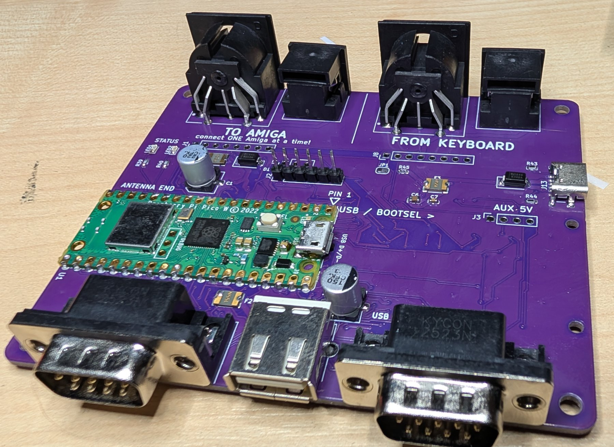
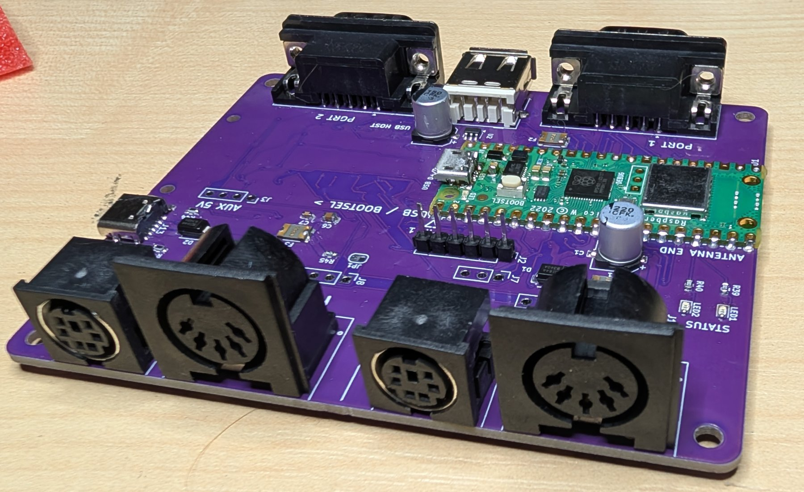
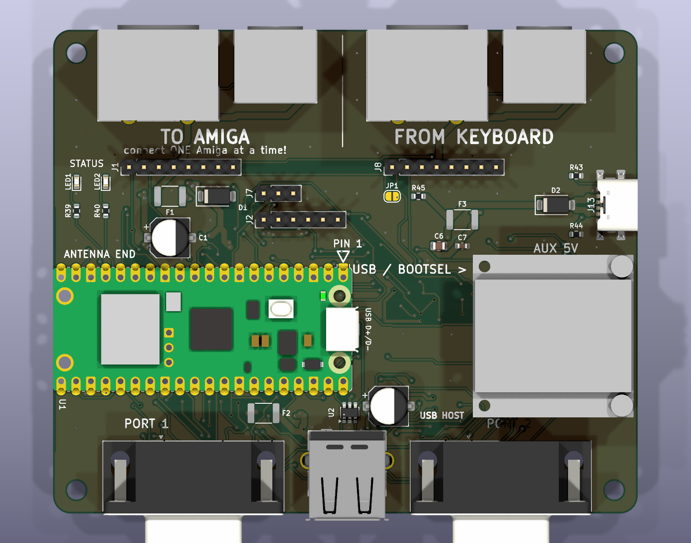

# UX rev 1 board guide

100 × 82.76 mm, two layers, hand-soldered. Internal name rev6; KiCad project in `kicad/rev6/`.

## connectors

| ref | what | note |
|---|---|---|
| J9 / J10 | **TO AMIGA** — DIN5 (A2000/A3000/A4000T) / mini-DIN6 (A4000) keyboard out | use one of them: *connect ONE Amiga at a time* |
| J11 / J12 | **FROM KEYBOARD** — DIN5 / mini-DIN6 real keyboard in | the Amiga keyboard plugs in here |
| J1 / J8 | A500 keyboard header out / in | 8-pin, A500 pinout; pin 7 power LED via JP1 |
| P1 / P2 | DE9 **male** controller ports 1 / 2 | straight-through F-F cable to the Amiga (not null-modem). P2 wired, no firmware yet |
| J4 | USB-A host | keyboards, mice, a hub (one level) |
| J13 | USB-C aux 5 V in | power only, no data |
| J3 | OLED socket, 1×4 female | **GND · VCC · SCL · SDA** — the common 0.96″ SSD1306 order |
| J2 | debug: GND · TX · RX · SWDIO · GND · SWCLK | UART 115200, 3.3 V |
| J7 | spare GP28 · 3V3 · GND | unused |
| JP1 | solder jumper | bridge to light an A500 keyboard's power LED, otherwise leave open |

## power

Normally from the Amiga through the keyboard connector: `AMIGA_5V → F1 → D1 → SYS5V → Pico VSYS`.
USB-C (J13) through D2 is the alternative. The DE9 ports take no power. Cabling only the joystick
ports to a running Amiga leaves the board dead and the port lines dragged low — connect keyboard
or USB-C first.

**F1 ships unfitted.** First power: current-limited bench 5 V into J13, measure the stack, fit
MF-MSMF030 / 050 / 075 to suit. Sequence in the [design notes](../kicad/rev6/DESIGN-NOTES.md).

## the Pico

Pico W or Pico 2 W, soldered flat by its castellations or on two 1×20 sockets for prototyping.
With the module soldered flat, J4 reaches the Pico's USB through the two plated half-holes in the
slot under it (short wires to TP2/TP3). On sockets, J4 is dead — use an OTG adapter on the Pico's
own micro-USB instead; Bluetooth works either way.

**Flash the image for your module.** A Pico W with the `pico2_w` image (or the reverse) is
silently dead: no USB, no serial, no LED. Recover with BOOTSEL and the right file.

## cautions

* **Micro-USB cable:** the Pico's port sits under the west edge of the OLED (11 mm above the
  board) and next to the Pico's own pins — use a cable with a slim plug; chunky overmoulds don't fit.
* **South edge:** 3.7 mm between each DE9 and the USB-A. Slim D-sub hoods, or a short USB extension.
* **Only hand assembly is tested.** The JLCPCB assembled variant has not been ordered or verified.
* **D10–D30 are optional.** They're ESD clamps on the Amiga-facing lines. The board works without
  them; fit them on a unit that lives on a real Amiga with cables being swapped.
* **Polarity, hand-soldered:** D1/D2 cathode (band) toward `SYS5V` (west); C1/C4 `+` per silk;
  U2 pin 1 per silk arrow; LED1/LED2 cathode toward the south edge.
* After flashing, the Pico's USB is a **host** — it never shows up on a PC. To re-enter BOOTSEL
  hold the button and short the RUN castellation to GND (the bulk caps keep the chip alive through a
  quick unplug), or leave it unpowered for 15 s.

## display

0.96″ SSD1306, 27.5 × 27.8 mm module with 23.5 × 23.8 mm holes, plugs onto J3 and screws to the
two M2 posts H1/H2. Posts = socket height + 2.54 mm: **11 mm for the 8.4 mm socket**. Image top is
the socket edge (north); flip in firmware if the case wants it the other way.

## files

* `kicad/rev6/fab/` — gerbers as ordered, `ORDER-CHECKLIST.md` (JLCPCB form, field by field),
  `fit-check-1to1.pdf` (print at 100 %, lay the connectors on it before ordering).
* `kicad/rev6/rev6-mouser-bom.md` + `rev6-ux-mouser-cart.csv` — parts, Mouser-importable.
* `kicad/rev6/bom/ibom.html` — interactive BOM (InteractiveHtmlBom); open in a browser to find
  every part on the board while hand-soldering.
* `kicad/rev6/mech/` — STEP/STL, board-only and full assembly, for the case.
* `tools/check_rev6_*.py` — the board gates; run them before committing any board change.
